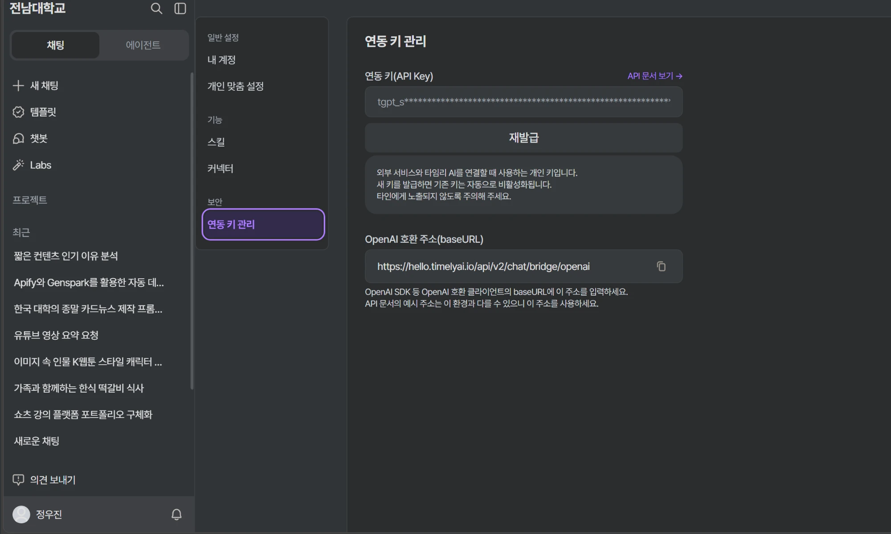
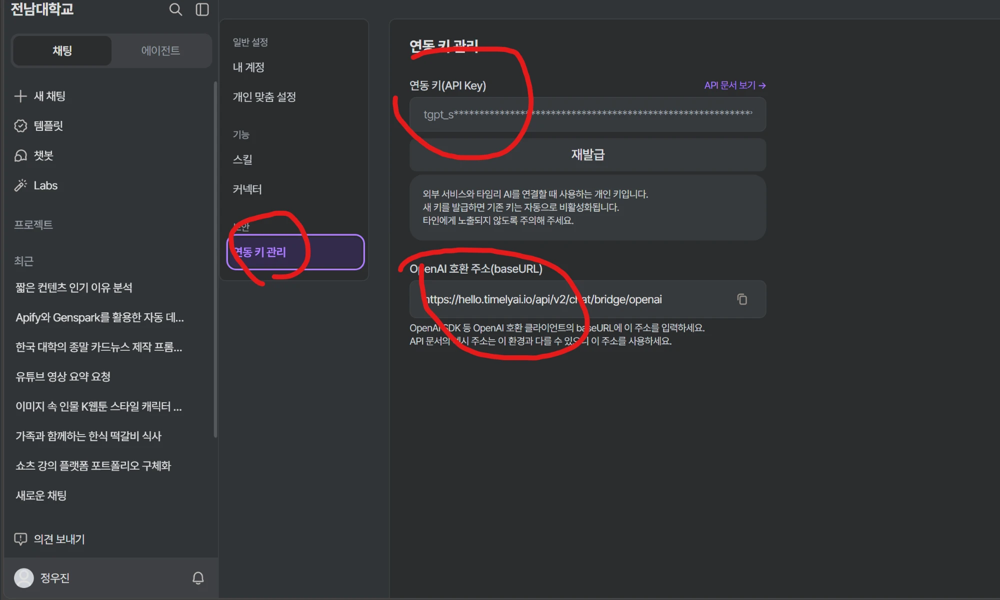
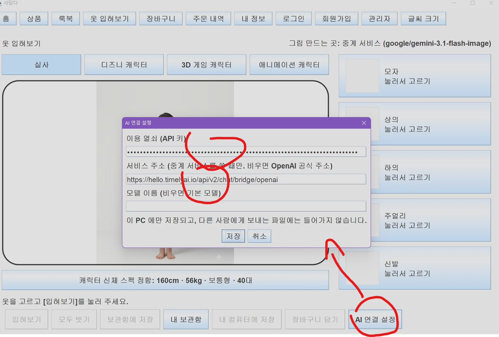

# 상품·추천 도메인과 옷 입혀보기

담당: 정우진 (Model — 상품·추천 도메인). 팀 공용 설명은 [README](../README.md)를 봅니다.

## 구현 범위

| 기능 | 코드 | 관련 요구사항 |
|------|------|---------------|
| 상품·카테고리 데이터, 카테고리별 조회, [더 보기] | `model/product/ProductService`, `ProductSeedLoader` | FR-05, UC-04 |
| 검색·필터·정렬 (키워드, 연령대, 체형, 사이즈, 가격대, 색상 / 인기·신상품·가격순) | `ProductService.search`, `SearchFilter` | FR-06, FR-07, UC-05 |
| 룩북 코디 조회 (상황·계절), 코디 등록·수정·삭제 | `model/recommend/RecommendService`, `Lookbook` | FR-09, FR-26, UC-07, UC-17 |
| 유행 아이템, 연령대·체형 맞춤 추천 | `RecommendService.findTrendingItems`, `recommendFor` | FR-11, FR-12, UC-08 |
| 합성 이미지 보관함 (저장·목록·삭제) | `model/tryon/TryOnService`, `view/tryon/LockerDialog` | FR-16, NFR-08 |
| 옷 입혀보기 (캐릭터에 상품을 AI로 입히기) | `view/tryon/TryOnPanel`, `controller/TryOnController`, `external/*DressUp*`, `model/tryon` | UC-09 확장 |
| 업로드 사진 정리 (합성 뒤 삭제, 다시 켤 때 남은 사진 삭제) | `TryOnService.deleteUpload`, `deleteLeftoverUploads` | NFR-08 |
| 홈(첫 화면): 검색창, 카테고리로 찾기, 나에게 어울리는 상품, 유행 아이템, 추천 코디, 새로 들어온 상품 | `view/recommend/HomePanel` | UC-04, UC-07, UC-08 |
| 상품 목록: 큰 카테고리 버튼, 검색, 필터·정렬, [내 체형에 맞는 상품], [더 보기], 결과 없음 안내 | `view/product/ProductListPanel`, `CategoryBar`, `ProductGrid`, `ProductCard` | UC-04, UC-05 |
| 상품 정보 창: 큰 사진, 소재·코디 포인트, 옵션, [장바구니 담기] [찜하기] | `view/product/ProductInfoDialog` | UC-06 요약 |
| 룩북: 상황·계절 고르기, 코디 보기, [코디 전체 담기], 관리자 [새 코디 올리기]·수정·삭제 | `view/recommend/LookbookPanel`, `LookbookEditorDialog` | UC-07, UC-17 |

## 화면 (View)

다른 브랜치와 부딪히지 않도록 아래처럼 만들었습니다.

- `MainFrame`은 고치지 않았습니다. 화면이 보일 때마다 내용을 새로 읽으므로(`ShopUi.whenShown`) 로그인·로그아웃 뒤에도 맞춤 추천이 바로 바뀝니다.
- `ScreenPanel`은 `feat/auth-view` 브랜치와 **똑같은 내용**으로 맞췄습니다(`setContent`, `hideTitle`). 두 브랜치를 합쳐도 충돌하지 않습니다.
- 색은 `feat/auth-view`의 `Theme`과 같은 값을 `ShopUi`에 두었습니다. 그 브랜치가 합쳐지면 `ShopUi`의 색 상수를 `Theme` 상수로 바꿔도 됩니다.
- 상품 카드를 누르면 `ShopUi.openProduct`가 상품 정보 창을 엽니다. 상품 상세 화면(`ProductDetailPanel`, UC-06)이 완성되면 이 메서드 하나만 바꾸면 됩니다.
- 홈에서 카테고리·검색어·코디를 누르면 `ProductListPanel.showCategory/showSearch`, `LookbookPanel.showLookbook`을 부른 뒤 그 화면으로 이동합니다.
- 장바구니·찜(백예원)과 로그인(회원 도메인)이 아직 TODO라서, 지금은 [장바구니 담기]를 누르면 "로그인이 필요한 기능입니다" 또는 "준비 중" 안내가 나옵니다. 구현되면 화면은 고치지 않아도 그대로 동작합니다.
- 코디 올리기·수정·삭제는 관리자로 로그인했을 때만 룩북 화면에 버튼이 보입니다.

## 데모 데이터

- `src/main/resources/data/products.tsv`: 팀 구글 시트의 테스트 데이터 300개입니다. (https://docs.google.com/spreadsheets/d/1OEbyJTQ3_8mpnIesrYRcQPwiPQlF9hbfUxq6GUTmyi4/edit?gid=0#gid=0) 모자 30, 상의 30, 하의 30, 신발 90, 양말 30, 주얼리 90개가 들어 있습니다.
- 시트의 "현지표시가"와 "이미지 속성" 열은 쓰지 않습니다. 가격은 숫자로 바꿔 넣습니다.
- 데이터에 없는 값은 임시 규칙으로 채웁니다 (`ProductSeedLoader`, `RecommendService` 주석).
  - 옵션·재고: 카테고리별 기본 사이즈 × 소재 문구의 색상, 재고 10
  - 유행 아이템: 세부 카테고리마다 앞의 2개 (`-01`, `-02`), 모두 20개
  - 룩북: 나라별 데모 코디 6개
- DB가 정해지기 전까지 상품·룩북은 메모리에만 둡니다. 관리자 화면에서 바꾼 내용은 프로그램을 끄면 사라집니다.

## 옷 입혀보기

상단 메뉴 [옷 입혀보기]에서 캐릭터(실사·디즈니 캐릭터·3D 게임 캐릭터·애니메이션 캐릭터)에 모자·상의·하의·주얼리·신발을 입혀 봅니다.

- [캐릭터 신체 스펙 정함]에서 키·몸무게·체형·연령대를 바꾸면 캐릭터 모습이 바로 바뀝니다.
- [입혀보기]를 누르면 AI가 캐릭터에 고른 상품을 입힌 그림을 만듭니다. 결과는 [보관함에 저장], [내 컴퓨터에 저장], [장바구니 담기]로 처리합니다.
- 상품 사진을 구한 상품은 AI가 **사진만** 보고 그립니다. 상품명·색상 글은 보내지 않습니다. 데이터에서 이름과 사진이 다른 상품이 있어서, 글을 함께 보내면 화면의 사진과 다른 결과가 나왔기 때문입니다. 사진을 구하지 못한 상품만 글로 설명합니다.
- [내 보관함]에서 저장한 그림을 보고, 고른 그림을 지울 수 있습니다. 지운 그림은 이 PC의 보관함 폴더(`사용자 홈/.sadamda/tryon/locker`)에서도 사라집니다. 보관함은 로그인한 회원만 쓸 수 있습니다.

## API 키 생성 및 입력 방법

AI 합성에는 이용 열쇠(API 키)가 필요합니다. 아래는 학교에서 쓰는 타임리 AI의 연동 키를 쓰는 방법입니다.

**1. 타임리 AI에서 연동 키 관리 화면을 엽니다.**
설정 화면의 "보안" 아래 [연동 키 관리]를 누릅니다.



**2. 연동 키(API Key)와 OpenAI 호환 주소(baseURL)를 복사합니다.**
- 연동 키는 `tgpt_s`로 시작합니다. 키가 없으면 [재발급]을 누릅니다. 새 키를 받으면 전에 쓰던 키는 더 이상 쓸 수 없습니다.
- OpenAI 호환 주소는 오른쪽 복사 버튼으로 복사합니다.



**3. 사담다에서 [옷 입혀보기] → [AI 연결 설정]을 누르고 값을 넣습니다.**
- 이용 열쇠 (API 키): 2단계에서 복사한 연동 키
- 서비스 주소: 2단계에서 복사한 OpenAI 호환 주소
- 모델 이름: 비워 둡니다. 비우면 기본 모델(`google/gemini-3.1-flash-image`)을 씁니다.
- [저장]을 누르면 화면 위쪽에 "그림 만드는 곳: 중계 서비스 (google/gemini-3.1-flash-image)"가 보입니다.



> 중계 서비스를 쓸 때 서비스 주소를 비우면 OpenAI 공식 주소로 연결되어 실패합니다.
> 넣은 값은 이 PC의 사용자 설정(`java.util.prefs`)에만 저장됩니다. 코드, 저장소, jar 파일에는 들어가지 않습니다.
> 연동 키는 다른 사람에게 보여 주거나 저장소에 올리지 마세요.

### 환경 변수로 넣기

화면 대신 환경 변수(또는 같은 이름의 `-D` 옵션)로 줄 수도 있습니다. 환경 변수가 있으면 화면에서 넣은 값보다 먼저 씁니다.

| 환경 변수 | 뜻 | 기본값 |
|-----------|----|--------|
| `OPENAI_API_KEY` | OpenAI 공식 또는 호환 중계 서비스 키 | (없음) |
| `OPENAI_BASE_URL` | 중계 서비스 주소 | `https://api.openai.com/v1` |
| `GEMINI_API_KEY` | Google Gemini 키 (`AIza…`) | (없음) |
| `SADAMDA_AI_PROVIDER` | `openai` · `gemini` 로 강제 지정 | 키 모양으로 자동 선택 |
| `SADAMDA_AI_API` | OpenAI 형식의 보내는 방식 `images` · `chat` | 공식 주소는 `images`, 중계 주소는 `chat` |
| `SADAMDA_AI_MODEL` | 이미지 모델 이름 | images `gpt-image-2` / chat `google/gemini-3.1-flash-image` / Gemini `gemini-3.1-flash-image` |
| `SADAMDA_AI_QUALITY` | OpenAI 형식 품질 `low`·`medium`·`high`·`auto` | `medium` |
| `SADAMDA_AI_TIMEOUT` | 기다리는 시간(초) | 60 |

```powershell
$env:OPENAI_API_KEY="연동키"; $env:OPENAI_BASE_URL="https://hello.timelyai.io/api/v2/chat/bridge/openai"; java -jar target/sadamda-0.1.0-SNAPSHOT.jar
```

키가 하나도 없으면 외부로 아무것도 보내지 않고, 화면에 연결 설정 안내만 보여 줍니다 (`UnconnectedDressUpClient`).

## 점검

상품·추천·보관함 도메인과 옷 입혀보기 연동을 한 번에 확인하는 실행형 검사입니다 (인터넷·API 키 불필요, 130개).

```bash
mvn test-compile
# Mac/Linux
java -cp target/classes:target/test-classes com.sadamda.DomainSelfCheck
# Windows
java -cp "target/classes;target/test-classes" com.sadamda.DomainSelfCheck
```

## 아직 남은 것

- 연령대·체형 태그: 데모 데이터에 없어서 상품명·코디 문구로 추정한 임시 값입니다 (`ProductTags.guessAgeGroups`, `guessBodyTypes`). 40대는 캐주얼·트렌디, 50대는 단정·우아, 60대는 편안함 위주이고, 어느 쪽에도 해당하지 않으면 세 연령대 모두입니다. 실제 값이 정해지면 데이터나 관리자 화면에서 바꿔 주세요.
- 데이터 불일치: `HAT-KR-02`는 이름이 "블랙 버킷햇"인데 사진은 회색 니트 후드입니다. 다른 상품은 아직 확인하지 않았습니다.
- 업로드 사진 삭제: `feat/tryon`의 `TryOnController.generate`는 인물 사진을 파일로 남기지 않고 메모리에서만 씁니다. 파일로 잠시 보관하는 방식으로 바뀌면 `storeUpload` → 합성 → `deleteUpload`(finally)로 지우면 됩니다. 프로그램이 합성 중에 꺼져 남은 사진은 다음 실행 때 `deleteLeftoverUploads`가 지웁니다.
- 로그인(회원 도메인)이 구현되기 전까지 보관함, 장바구니 담기, 맞춤 추천, 관리자 코디 올리기는 화면에서 쓸 수 없습니다.
- 데모 데이터는 판매 수량이 모두 0이라 인기순이 "유행 아이템 → 등록 순"으로 정해집니다. 그래서 홈에는 인기 상품 대신 새로 들어온 상품을 보여줍니다.

---

## 다른 브랜치와 합칠 준비 — 2026-11-14

브랜치를 아직 합치지 않고, **나중에 합칠 때 충돌·컴파일 오류가 나지 않도록** 이 브랜치만 고쳤습니다.
기준: `feat/product-view`(강준서, 상품 목록·검색·상세 View), `feat/member-model`·`feat/myinfo-view`·`feat/auth-view`·`feat/member`, `feat/tryon`·`feat/order-manage(-v2)`·`feat/order-payment`(김대원).

### 다른 담당자 파일은 건드리지 않음

| 파일 | 처리 |
|---|---|
| `view/MainFrame.java` | main 그대로 되돌림 (강준서 님이 새로 짬). [옷 입혀보기]는 홈 화면의 링크로 들어감 |
| `view/product/ProductListPanel.java` | main 그대로 되돌림 (강준서 님 화면이 들어올 자리) |
| `view/product/ProductCard.java` | 내 카드는 `ShopProductCard`로 이름 바꿈 (강준서 님 `ProductCard`와 같은 이름 충돌 방지) |
| `view/product/ProductImages.java` | `ProductThumbnails`로 이름 바꿈 (강준서 님 `view/ProductImages`와 헷갈림 방지) |
| `controller/TryOnController.java` | main 그대로 되돌림 (김대원 님 담당). 옷 입혀보기 기능은 새 `DressUpController`로 옮김 → `context.dressUp` |
| `controller/AppContext.java` | `dressUp` 줄만 추가. `tryOn` 생성 줄은 main 그대로 (feat/tryon 이 바꾸는 줄) |
| `external/AiImageClient` 예외 | 옷 입혀보기는 새 `DressUpException`을 씀 (feat/tryon 이 `AiImageException` 생성자를 바꿈) |
| `model/member/Member.java` | feat/member-model 과 글자 하나까지 같게 맞춤 |
| `model/product/Product.java` | feat/tryon 이 추가한 `getMainImageUrl()`을 같은 자리·같은 내용으로 넣음 |

### 강준서 님 화면이 보내는 값과 맞춤 (Model)

| 항목 | 내용 |
|---|---|
| 한 페이지 상품 수 | `ProductService.PAGE_SIZE` = **8** |
| 정렬 | `POPULAR`·`NEWEST`·`PRICE_LOW`·`PRICE_HIGH`도 받음 (한글 값도 그대로) |
| 체형 | 회원가입과 같은 값: 마른 체형, 보통 체형, 통통한 체형, 하체 발달형, 상체 발달형. 예전 값("보통형")도 받음 |
| 사이즈 | 옷 옵션 `S (55)`~`XL (88)`. `"66"`과 `"M (66)"`은 같은 사이즈 |
| "선택 안 함" | 조건 없음 |
| 색상 | "화이트·아이보리"처럼 `·`로 묶은 색은 하나만 맞아도 됨 |
| 가격 | `minPrice`·`maxPrice` 둘 다 포함 |
| 화면 색 | `ShopUi` 색을 `Theme`(흑백)과 같은 값으로 |

### 합친 뒤 자동으로 이어지는 것

- 홈·룩북에서 상품을 누르면: `MainFrame.openProduct(Long)`가 있으면 상품 상세 화면, 없으면(합치기 전) 임시 `ProductInfoDialog`.
- 홈의 카테고리 버튼·검색창: `ProductListPanel`에 `public openCategory(Category)`·`public openSearch(String)`이 있으면 그 카테고리·검색 결과로, 없으면 상품 화면만 엽니다. → **강준서 님께 두 메서드 추가를 부탁드릴 것.**

### 합친 뒤 할 일 (선택)

- `ProductListPanel`·`ProductDetailPanel`의 `MockProducts` 호출을 `context.product`로 바꾸기 (강준서 님 문서 4번).
- 상단 메뉴에 [옷 입혀보기] 추가 (`TryOnPanel.NAME`).
