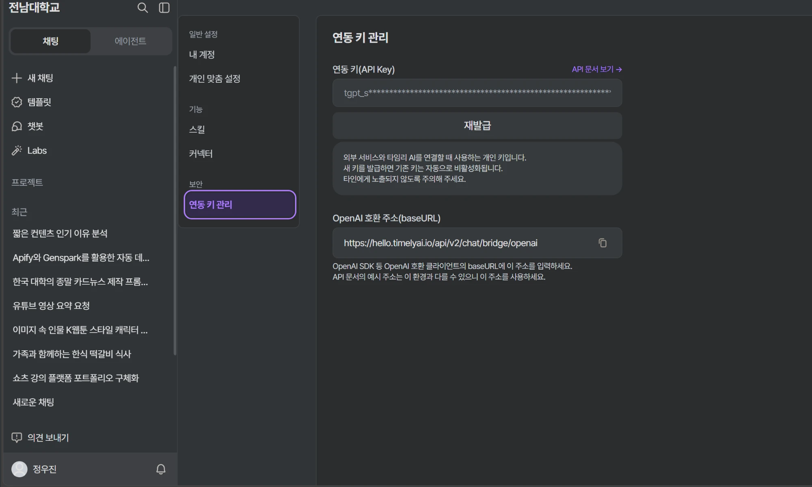
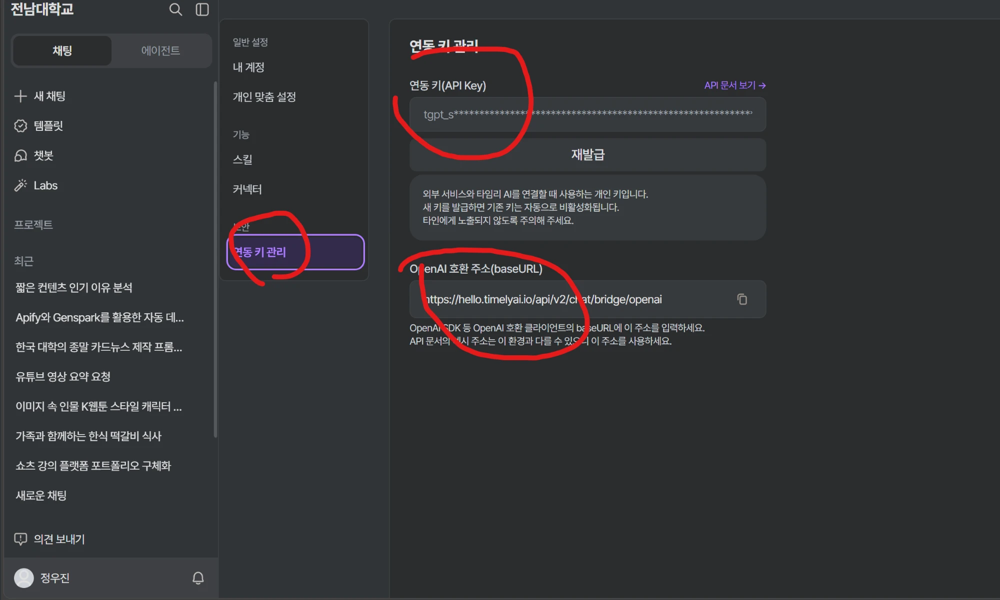
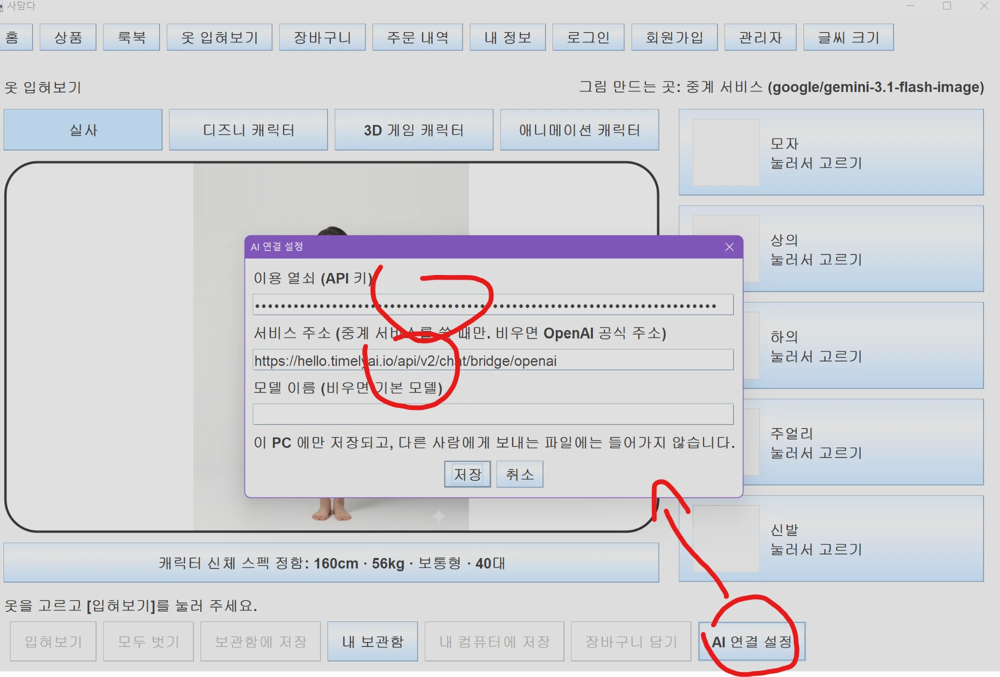

# 상품·추천 도메인과 옷 입혀보기

담당: 정우진 (Model — 상품·추천 도메인). 팀 공용 설명은 [README](../README.md)를 봅니다.

## 구현 범위

| 기능 | 코드 | 관련 요구사항 |
|------|------|---------------|
| 상품·카테고리 데이터, 카테고리별 조회, [더 보기] | `model/product/ProductService`, `ProductSeedLoader` | FR-05, UC-04 |
| 검색·필터·정렬 (키워드, 연령대, 체형, 사이즈, 가격대, 색상 / 인기·신상품·가격순) | `ProductService.search`, `SearchFilter` | FR-06, FR-07, UC-05 |
| 룩북 코디 조회 (상황·계절), 코디 등록·수정·삭제 | `model/recommend/RecommendService`, `Lookbook` | FR-09, FR-26, UC-07, UC-17 |
| 유행 아이템, 연령대·체형 맞춤 추천 | `RecommendService.findTrendingItems`, `recommendFor` | FR-11, FR-12, UC-08 |
| 합성 이미지 보관함 (저장·목록·삭제) | `model/tryon/TryOnService`, `view/tryon/LockerDialog` | FR-16, NFR-08 |
| 옷 입혀보기 (캐릭터에 상품을 AI로 입히기) | `view/tryon/TryOnPanel`, `controller/DressUpController`(`context.dressUp`), `external/*DressUp*`, `model/tryon` | UC-09 확장 |
| 내 사진으로 입어보기 (올린 전신 사진에 옷을 입히고 배경을 바꾸기), 사진 확인(동의·형식·용량·방향) | `view/tryon/PhotoUploadDialog`, `DressUpController.checkPhoto`·`dressUpPhoto`, `model/tryon/UserPhoto`, `DressUpPrompt.buildPhoto` | UC-09, NFR-08 |
| 배경 20장 (계절·나라별, 사람 없는 건물·자연), 배경 고르기 | `resources/data/backgrounds.tsv`, `model/tryon/Background`·`BackgroundCatalog`, `view/tryon/BackgroundTile`·`BackgroundDialog` | UC-09 (FR-14) |
| 입힐 아이템 14칸, 아이템 고르기 창 (주얼리 5종, 원피스 ↔ 상의·하의 규칙) | `model/tryon/DressUpSlot`·`Outfit`, `view/tryon/ItemPickerDialog` | UC-09 확장 |
| 업로드 사진 정리 (합성 뒤 삭제, 다시 켤 때 남은 사진 삭제). 지금 내 사진은 파일로 남기지 않아 쓰이지 않음 | `TryOnService.deleteUpload`, `deleteLeftoverUploads` | NFR-08 |
| 홈(첫 화면): 검색창, 카테고리로 찾기, 나에게 어울리는 상품, 유행 아이템, 추천 코디, 새로 들어온 상품 | `view/recommend/HomePanel` | UC-04, UC-07, UC-08 |
| 상품 목록: 큰 카테고리 버튼, 검색, 필터·정렬, [내 체형에 맞는 상품], [더 보기], 결과 없음 안내 | `view/product/ProductListPanel`, `CategoryBar`, `ProductGrid`, `ProductCard` | UC-04, UC-05 |
| 상품 정보 창: 큰 사진, 소재·코디 포인트, 옵션, [장바구니 담기] [찜하기] (상세 화면이 없을 때만 쓰는 임시 창. 지금은 상세 화면 `ProductDetailPanel`이 열림) | `view/product/ProductInfoDialog` | UC-06 요약 |
| 룩북: 상황·계절 고르기, 코디 보기, [코디 전체 담기], 관리자 [새 코디 올리기]·수정·삭제 | `view/recommend/LookbookPanel`, `LookbookEditorDialog` | UC-07, UC-17 |

## 화면 (View)

다른 브랜치와 부딪히지 않도록 아래처럼 만들었습니다.

> 아래는 다른 브랜치와 합치기 전에 쓴 내용입니다. 지금은 브랜치가 모두 합쳐져서 상품 카드를 누르면 상품 상세 화면이 열리고, 장바구니·찜·로그인도 실제로 동작합니다.

- `MainFrame`은 고치지 않았습니다. 화면이 보일 때마다 내용을 새로 읽으므로(`ShopUi.whenShown`) 로그인·로그아웃 뒤에도 맞춤 추천이 바로 바뀝니다.
- `ScreenPanel`은 `feat/auth-view` 브랜치와 **똑같은 내용**으로 맞췄습니다(`setContent`, `hideTitle`). 두 브랜치를 합쳐도 충돌하지 않습니다.
- 색은 `feat/auth-view`의 `Theme`과 같은 값을 `ShopUi`에 두었습니다. 그 브랜치가 합쳐지면 `ShopUi`의 색 상수를 `Theme` 상수로 바꿔도 됩니다.
- 상품 카드를 누르면 `ShopUi.openProduct`가 `MainFrame.openProduct(Long)`이 있으면 상품 상세 화면(`ProductDetailPanel`, UC-06)을, 없으면 임시 상품 정보 창을 엽니다. 지금은 `MainFrame`에 이 메서드가 있어서 상세 화면이 열립니다.
- 홈에서 카테고리·검색어·코디를 누르면 `ProductListPanel.showCategory/showSearch`, `LookbookPanel.showLookbook`을 부른 뒤 그 화면으로 이동합니다.
- 장바구니·찜(백예원)과 로그인(회원 도메인)은 구현되어 연결되었습니다. 비회원이 [장바구니 담기]를 누르면 "로그인이 필요한 기능입니다" 안내 뒤 로그인 화면으로 갑니다.
- 코디 올리기·수정·삭제는 관리자로 로그인했을 때만 룩북 화면에 버튼이 보입니다.

## 데모 데이터

- `src/main/resources/data/products.tsv`: 팀 구글 시트의 테스트 데이터 370개 중 350개입니다. (https://docs.google.com/spreadsheets/d/1OEbyJTQ3_8mpnIesrYRcQPwiPQlF9hbfUxq6GUTmyi4/edit?gid=0#gid=0) 상의 34, 하의 33, 원피스 5, 아우터 5, 모자 35, 신발 95, 양말 33, 주얼리 100, 가방 5, 스카프 5개가 들어 있습니다 (11-17에 300개 → 370개, [docs/ui-data-update.md](ui-data-update.md)). 11-24에 사진을 불러올 수 없는 상품 20개(사진 주소 403·404, 앱이 못 읽는 WebP)를 뺐습니다. 세트 상품 11개는 쇼핑몰에는 그대로 두고 옷 입혀보기에서만 고를 수 없게 했습니다 (`DressUpSlot.isSetProduct`).
- 시트의 "현지표시가"와 "이미지 속성" 열은 쓰지 않습니다. 가격은 숫자로 바꿔 넣습니다.
- 데이터에 없는 값은 임시 규칙으로 채웁니다 (`ProductSeedLoader`, `RecommendService` 주석).
  - 옵션·재고: 카테고리별 기본 사이즈 × 소재 문구의 색상, 재고 10
  - 유행 아이템: 세부 카테고리마다 앞의 2개 (`-01`, `-02`). 관리자 화면(UC-17)에서 지정·해제할 수 있습니다
  - 룩북: 나라별 데모 코디 6개
- DB가 정해지기 전까지 상품·룩북은 메모리에만 둡니다. 관리자 화면에서 바꾼 내용은 프로그램을 끄면 사라집니다.

## 옷 입혀보기

상단 메뉴 [옷 입혀보기]에서 캐릭터(실사·디즈니 캐릭터·3D 게임 캐릭터·애니메이션 캐릭터) 또는 **내 사진**에 상품을 입혀 봅니다. 화면은 2026-11-20에 승인한 시안을 따릅니다.

- [캐릭터 신체 스펙 정함]에서 키·몸무게·체형·연령대를 바꾸면 캐릭터 모습이 바로 바뀝니다.
- [입혀보기]를 누르면 AI가 캐릭터에 고른 상품을 입힌 그림을 만듭니다. 결과는 [보관함에 저장], [내 컴퓨터에 저장], [장바구니 담기]로 처리합니다.
- 상품 사진을 구한 상품은 AI가 **사진만** 보고 그립니다. 상품명·색상 글은 보내지 않습니다. 데이터에서 이름과 사진이 다른 상품이 있어서, 글을 함께 보내면 화면의 사진과 다른 결과가 나왔기 때문입니다. 사진을 구하지 못한 상품만 글로 설명합니다.
- 오른쪽 **입힐 아이템 14칸**은 옷(상의·하의·원피스·아우터) · 머리·목(모자·스카프) · 주얼리(귀걸이·목걸이·팔찌·뱅글·반지·브로치) · 발·소품(양말·신발·가방)으로 묶어 보여 줍니다. 입힌 칸은 굵은 테두리입니다.
- 칸이나 [한꺼번에 고르기]를 누르면 **아이템 고르기 창**이 열립니다. 왼쪽 카테고리 14개를 옮겨 다니며 큰 사진 카드의 [입히기]로 여러 개를 한 번에 고르고, 창을 닫으면 그대로 반영됩니다.
- 주얼리 세부 분류는 데이터에서 "귀걸이/브로치/반지"가 한 묶음이라 상품명으로 다시 나눕니다 (`DressUpSlot.slotFor`): 귀걸이 24 · 목걸이 35 · 팔찌 35 · 반지 2 · 브로치 9개.
- 원피스(투피스·셋업 포함)를 입히면 상의·하의가 벗겨지고, 상의나 하의를 입히면 원피스가 벗겨집니다 (`Outfit.put`이 벗긴 칸을 돌려주고 화면이 알려 줌).
- **상품 사진에서 그 칸의 물건 하나만 가져오기**: 상품 사진의 모델은 다른 옷·신발·가방을 함께 입고 있어서, AI가 고른 상품 대신 사진 속 다른 옷을 그리는 문제가 있었습니다(아우터 사진 속 안쪽 니트, 상의 사진 속 바지 등). 지시문에 칸별 규칙을 넣어 고쳤습니다 (`DressUpPrompt.ISOLATION`).
  - OUTFIT 목록의 칸마다 "가져올 것(TAKE)"과 "무시할 것(IGNORE)"을 적습니다. 예: 상의 사진에서는 목선부터 밑단·소맷단까지 상의만 가져오고 바지·치마·위에 걸친 코트·가방·장신구는 무시, 하의 사진에서는 허리부터 밑단까지 바지·치마만 가져오고 위에 입은 옷·양말·신발은 무시. 14칸 모두 정해 두었습니다.
  - SOURCE CHECK: "Image 2에서는 상의만, Image 3에서는 하의만…"처럼 사진마다 쓸 물건을 한 번 더 적고, 고르지 않은 부분은 캐릭터(또는 내 사진)의 원래 차림에서만 오게 합니다.
  - LAYERING: 아우터를 입히면 안에는 고른 상의(없으면 캐릭터의 흰 티셔츠, 내 사진이면 원래 상의)를 입히고, 가려지면 아우터 앞을 열어 보이게 합니다.
  - 2026-11-20~21에 실제 AI로 세 번 확인했습니다 (아우터 OUT-KR-02 + 닥스훈트 가디건 + 울 팬츠, 캐릭터·내 사진). 재킷 사진 속 겨자색 가디건·소맷단·치마가 더는 따라오지 않습니다. 다만 내 사진 모드에서 고르지 않은 신발을 AI가 그려 넣는 경우가 있습니다.
- [내 보관함]에서 저장한 그림을 보고, 고른 그림을 지울 수 있습니다. 지운 그림은 이 PC의 보관함 폴더(`사용자 홈/.sadamda/tryon/locker`)에서도 사라집니다. 보관함은 로그인한 회원만 쓸 수 있습니다.

### 내 사진으로 입어보기

1. 그림체 4개 아래 [내 사진으로 입어보기]를 누르면 **사진 올리기 창**이 열립니다. 잘 나오는 사진 안내(전신·정면·혼자·JPG·PNG 10MB 이하)와 좋은 예·나쁜 예 그림이 있습니다.
2. [사진 고르기…]로 사진을 고르면 미리보기가 나옵니다. JPG·PNG가 아니거나, 10MB가 넘거나, 열 수 없거나, 너무 작으면(200×300px 미만) 그 자리에서 빨간 글씨로 알려 줍니다 (UC-09 3a).
3. **사진 이용 동의(필수)**에 체크해야 [이 사진으로 입어보기]가 눌립니다 (UC-09 2a). 동의 문구에 사진이 그림 만드는 곳(AI 서비스)으로 보내진다는 것을 적었습니다.
4. 가운데 칸에 올린 사진이 보이고 [사진 바꾸기]·[사진 지우기]가 붙습니다. 몸은 사진 그대로라 [신체 스펙] 대신 **배경 고르기**가 나옵니다.
5. 배경은 계절 칩(전체·봄·여름·가을·겨울)으로 거르고, 실제 배경 사진 위에 "봄 · 일본 / 벚꽃 가로수길"처럼 이름을 얹은 버튼을 누릅니다. "원래 배경"은 사진의 배경을 그대로 둡니다.
   - 배경 줄은 **옆으로 넘겨** 봅니다 (`BackgroundSlider`): 양쪽 둥근 [‹] [›] 버튼(끝에 닿으면 흐려짐), 마우스로 끌기, 휠 굴리기. 키보드로 버튼에 오면 그 버튼이 보이게 넘어갑니다. 고른 배경은 줄을 다시 만들 때 보이는 곳으로 넘깁니다.
   - [배경 20개 모두 보기 ›]는 계절 칩과 같은 줄 오른쪽 끝에 있고, 계절별로 크게 보여 줍니다.
6. [입혀보기]를 누르면 AI가 사진 속 사람의 얼굴·체형·자세는 그대로 두고 고른 옷을 입히고, 배경을 고르면 그 장소에서 찍은 사진처럼(빛·크기·원근·그림자) 넣습니다. 옷 없이 배경만 바꿀 수도 있습니다. 결과는 캐릭터와 같은 버튼으로 저장·장바구니 처리합니다.

**큰 그림 칸**: 그림 칸을 누르거나 오른쪽 위 [크게 보기]를 누르면 크게 보기 창(`ImageViewerDialog`)이 열립니다. 화면 거의 전체에 보여 주고, [크게 +]·[작게 −]·[화면에 맞추기], 마우스 휠, 끌어서 옮기기, 두 번 누르기로 확대해 봅니다. [입혀보기]가 끝나면 결과를 이 창으로 바로 띄웁니다.
세로 그림이라 생기는 좌우 여백은 비워 두지 않습니다 (`CharacterView`). 내 사진에 배경을 골랐으면 그 배경 사진을 흐리게 깔아(입혀 보기 전에는 장소 미리보기, 뒤에는 결과와 이어짐), 캐릭터 4종·원래 배경·결과에는 보여 주는 그림 자체를 크게 늘려 흐리게 깔아 스튜디오 배경이 좌우로 이어지게 합니다. 저장되는 그림은 가운데 세로 그림 그대로입니다.

**화면 높이**: 맨 아래 [입혀보기]·결과 버튼 줄은 스크롤 밖에 고정해서 창이 작아도 늘 보입니다. 그림체 버튼은 폭이 넓으면 한 줄, 좁으면 두세 줄로 놓고(`TryOnUi.Rows`), 창이 작으면 큰 그림 칸이 최소 높이(180px)까지 먼저 줄어든 다음에야 스크롤이 생깁니다. 1440×852 화면에서 최대화하면 내 사진 모드도 스크롤 없이 한 화면에 들어갑니다.

옷 입혀보기 화면들의 스크롤 막대는 옛날식 화살표·네모 막대 대신 앱의 알약 버튼과 어울리는 얇고 둥근 막대입니다 (`ModernScrollBar`, 평소 연한 회색 → 마우스를 올리면 진한 회색 → 끌면 검정).

AI에 보내는 이미지 순서는 1 = 내 사진, 2 = 배경 사진(골랐을 때), 그다음 상품 사진입니다 (`DressUpImageClient.Request.photo`, 지시문 `DressUpPrompt.buildPhoto`). 2026-11-20에 타임리 AI로 한 번 실제로 돌려 14초 만에 결과를 받았습니다.

**사진 개인정보 (NFR-08)**
- 올린 사진은 파일로 저장하지 않고 메모리(`UserPhoto`)에만 둡니다. [사진 지우기], 다른 사진 고르기, 앱 종료 때 사라집니다.
- 원본 파일 내용은 들고 있지 않고, AI로 보낼 때는 긴 변 1536px JPEG로 다시 만들어 보냅니다. 그래서 촬영 위치(GPS) 같은 EXIF 정보가 빠집니다.
- 휴대폰 사진은 EXIF 방향값을 읽어 바로 세웁니다 (Java 의 ImageIO 는 방향값을 무시해서 옆으로 누운 사진이 됩니다).

**배경 데이터** (`src/main/resources/data/backgrounds.tsv`)
- 원본은 구글 시트 "background"입니다 (poger2027@gmail.com 드라이브). 열: id · 배경 이름 · 이미지 url · IMAGE(url) · 계절 · 국가 · 종류 · 핀 주소. 시트의 IMAGE 칸은 처음 열 때 [액세스 허용]을 한 번 눌러야 사진이 보입니다.
- Pinterest 검색은 로그인이 필요해서, 웹 검색으로 찾은 공개 핀 페이지의 대표 사진 주소를 모았습니다. 20장 모두 열어 사람이 없는 것을 확인했습니다. 계절마다 5장, 한국·일본·미국 4장, 프랑스·이탈리아 3장, 영국 2장, 건물 10 · 자연 10.
- 앱의 TSV에는 버튼에 쓸 **짧은 이름** 열을 더했습니다 (시트에는 없음). 시트를 고치면 TSV도 함께 고쳐 주세요.
- 사진 파일은 저장소에 넣지 않고 주소만 둡니다 (상품 사진과 같은 이유). 출처는 핀 주소 열에 남겼습니다. BG-19(북촌)는 왼쪽 위에 사진가 표기가, BG-17(버몬트)은 왼쪽 아래에 희미한 표기가, BG-07(토스카나)은 얇은 테두리가 있습니다.

## API 키 생성 및 입력 방법

AI 합성에는 이용 열쇠(API 키)가 필요합니다. 아래는 학교에서 쓰는 타임리 AI의 연동 키를 쓰는 방법입니다.

**1. 타임리 AI에서 연동 키 관리 화면을 엽니다.**
설정 화면의 "보안" 아래 [연동 키 관리]를 누릅니다.



**2. 연동 키(API Key)를 복사합니다.**
- 연동 키는 `tgpt_s`로 시작합니다. 키가 없으면 [재발급]을 누릅니다. 새 키를 받으면 전에 쓰던 키는 더 이상 쓸 수 없습니다.
- 화면의 OpenAI 호환 주소(baseURL)는 복사하지 않아도 됩니다. 이 주소는 2026년 11월 18일에 종료되었습니다.



**3. 사담다에서 [옷 입혀보기] → [AI 연결 설정]을 누르고 값을 넣습니다.**
- 이용 열쇠 (API 키): 2단계에서 복사한 연동 키
- 서비스 주소, 모델 이름: 비워 둡니다. 타임리 연동 키는 적어도 쓰지 않습니다.
- [저장]을 누르면 화면 위쪽에 "그림 만드는 곳: 타임리 AI (edit_image)"가 보입니다.



> 타임리 AI는 2026년 11월 18일에 OpenAI 호환 주소(`.../bridge/openai`)를 닫았고, 새 Timely API(`.../direct/...`)는 글만 돌려줍니다. 그래서 사담다는 타임리 연동 키(`tgpt_`로 시작)를 받으면 타임리 SDK API의 내장 도구 `edit_image`로 그림을 만듭니다. 기본 캐릭터와 상품 사진을 참조 그림으로 보내면 타임리가 gpt-image 계열 모델로 새로 그려 줍니다 (`TimelyDressUpClient`). 한 번에 15~25초쯤 걸리고 타임리 크레딧이 듭니다.
> 만든 그림을 내려받는 주소(`timelyai.io/proxy/api/file/...`)는 타임리 웹 화면이 쓰는 주소이고 공개 문서에는 없습니다. 타임리가 이 주소를 바꾸면 "그림은 만들었지만 내려받지 못했습니다"가 나오므로 `TimelyDressUpClient.FILE_BASE`를 고쳐야 합니다.
> 예전에 저장해 둔 타임리 OpenAI 호환 주소는 자동으로 지웁니다. 다른 중계 서비스는 서비스 주소를 꼭 넣어야 합니다. 비우면 OpenAI 공식 주소로 연결되어 실패합니다.
> 키·주소를 복사할 때 섞여 들어온 앞뒤 공백, 줄바꿈, 따옴표, `Bearer `, 주소 끝의 `/chat/completions`는 저장할 때 자동으로 지웁니다.
> 키가 거절되면 타임리 AI에서 연동 키를 다시 복사해 넣으세요. [재발급]을 누르면 전에 쓰던 키는 더 이상 쓸 수 없습니다.
> 넣은 값은 이 PC의 사용자 설정(`java.util.prefs`)에만 저장됩니다. 코드, 저장소, jar 파일에는 들어가지 않습니다.
> 연동 키는 다른 사람에게 보여 주거나 저장소에 올리지 마세요.

### 환경 변수로 넣기

화면 대신 환경 변수(또는 같은 이름의 `-D` 옵션)로 줄 수도 있습니다. 화면에서 키를 저장했으면 화면 값을 먼저 쓰고, 화면에 키가 없을 때만 환경 변수를 씁니다. 다른 프로그램 때문에 `OPENAI_API_KEY`를 넣어 둔 PC에서도 화면에 넣은 타임리 키가 쓰이게 하기 위해서입니다.

| 환경 변수 | 뜻 | 기본값 |
|-----------|----|--------|
| `OPENAI_API_KEY` | 타임리 연동 키, OpenAI 공식 또는 호환 중계 서비스 키 | (없음) |
| `OPENAI_BASE_URL` | 중계 서비스 주소 | `https://api.openai.com/v1` |
| `GEMINI_API_KEY` | Google Gemini 키 (`AIza…`) | (없음) |
| `SADAMDA_AI_PROVIDER` | `openai` · `gemini` 로 강제 지정 | 키 모양으로 자동 선택 |
| `SADAMDA_AI_API` | OpenAI 형식의 보내는 방식 `images` · `chat` | 공식 주소는 `images`, 중계 주소는 `chat` |
| `SADAMDA_AI_MODEL` | 이미지 모델 이름 | images `gpt-image-2` / chat `google/gemini-3.1-flash-image` / Gemini `gemini-3.1-flash-image` |
| `SADAMDA_AI_QUALITY` | OpenAI 형식 품질 `low`·`medium`·`high`·`auto` | `medium` |
| `SADAMDA_AI_TIMEOUT` | 기다리는 시간(초) | 60 |

```powershell
$env:OPENAI_API_KEY="연동키"; java -jar target/sadamda-0.1.0-SNAPSHOT.jar
```

키가 하나도 없으면 외부로 아무것도 보내지 않고, 화면에 연결 설정 안내만 보여 줍니다 (`UnconnectedDressUpClient`).

## 점검

상품·추천·보관함 도메인과 옷 입혀보기 연동을 한 번에 확인하는 실행형 검사입니다 (인터넷·API 키 불필요, 192개).

```bash
mvn test-compile
# Mac/Linux
java -cp target/classes:target/test-classes com.sadamda.DomainSelfCheck
# Windows
java -cp "target/classes;target/test-classes" com.sadamda.DomainSelfCheck
```

## 아직 남은 것

- 연령대·체형 태그: 데모 데이터에 없어서 상품명·코디 문구로 추정한 임시 값입니다 (`ProductTags.guessAgeGroups`, `guessBodyTypes`). 40대는 캐주얼·트렌디, 50대는 단정·우아, 60대는 편안함 위주이고, 어느 쪽에도 해당하지 않으면 세 연령대 모두입니다. 실제 값이 정해지면 데이터나 관리자 화면에서 바꿔 주세요.
- 데이터 불일치: `HAT-KR-02`는 이름이 "블랙 버킷햇"인데 사진은 회색 니트 후드입니다. 다른 상품은 아직 확인하지 않았습니다.
- 업로드 사진 삭제: 내 사진으로 입어보기는 사진을 파일로 남기지 않아 `storeUpload`·`deleteUpload`를 쓰지 않습니다. 나중에 파일로 잠시 보관하는 방식으로 바뀌면 `storeUpload` → 합성 → `deleteUpload`(finally)로 지우면 됩니다.
- UC-09 사진 합성은 `DressUpController.dressUpPhoto`(실제 AI, 옷 여러 개 + 배경)로 구현했습니다. 김대원 님의 `TryOnController.generate`(가짜 AI, 상품 하나)는 여전히 `UnsupportedOperationException("TODO UC-09 (계획 4단계)")`이고 화면은 쓰지 않습니다. PR #4(`feat/tryon`)를 닫을지, `generate`가 `dressUpPhoto`를 부르게 할지 팀에서 정해야 합니다.
- 사람 인식 실패(UC-09 7a): AI 서비스가 따로 알려 주지 않아서, 사람이 없는 사진도 그대로 보냅니다. 사진 올리기 창의 안내로 대신합니다.
- 데모 데이터는 판매 수량이 모두 0이라 인기순이 "유행 아이템 → 등록 순"으로 정해집니다. 그래서 홈에는 인기 상품 대신 새로 들어온 상품을 보여줍니다.

---

## 다른 브랜치와 합칠 준비 — 2026-11-14

브랜치를 아직 합치지 않고, **나중에 합칠 때 충돌·컴파일 오류가 나지 않도록** 이 브랜치만 고쳤습니다.
기준: `feat/product-view`(강준서, 상품 목록·검색·상세 View), `feat/member-model`·`feat/myinfo-view`·`feat/auth-view`·`feat/member`, `feat/tryon`·`feat/order-manage(-v2)`·`feat/order-payment`(김대원).

### 다른 담당자 파일은 건드리지 않음

| 파일 | 처리 |
|---|---|
| `view/MainFrame.java` | main 그대로 되돌림 (강준서 님이 새로 짬). [옷 입혀보기]는 홈 화면의 링크로 들어감 |
| `view/product/ProductListPanel.java` | main 그대로 되돌림 (강준서 님 화면이 들어올 자리) |
| `view/product/ProductCard.java` | 내 카드는 `ShopProductCard`로 이름 바꿈 (강준서 님 `ProductCard`와 같은 이름 충돌 방지) |
| `view/product/ProductImages.java` | `ProductThumbnails`로 이름 바꿈 (강준서 님 `view/ProductImages`와 헷갈림 방지) |
| `controller/TryOnController.java` | main 그대로 되돌림 (김대원 님 담당). 옷 입혀보기 기능은 새 `DressUpController`로 옮김 → `context.dressUp` |
| `controller/AppContext.java` | `dressUp` 줄만 추가. `tryOn` 생성 줄은 main 그대로 (feat/tryon 이 바꾸는 줄) |
| `external/AiImageClient` 예외 | 옷 입혀보기는 새 `DressUpException`을 씀 (feat/tryon 이 `AiImageException` 생성자를 바꿈) |
| `model/member/Member.java` | feat/member-model 과 글자 하나까지 같게 맞춤 |
| `model/product/Product.java` | feat/tryon 이 추가한 `getMainImageUrl()`을 같은 자리·같은 내용으로 넣음 |

### 강준서 님 화면이 보내는 값과 맞춤 (Model)

| 항목 | 내용 |
|---|---|
| 한 페이지 상품 수 | `ProductService.PAGE_SIZE` = **8** |
| 정렬 | `POPULAR`·`NEWEST`·`PRICE_LOW`·`PRICE_HIGH`도 받음 (한글 값도 그대로) |
| 체형 | 회원가입과 같은 값: 마른 체형, 보통 체형, 통통한 체형, 하체 발달형, 상체 발달형. 예전 값("보통형")도 받음 |
| 사이즈 | 옷 옵션 `S (55)`~`XL (88)`. `"66"`과 `"M (66)"`은 같은 사이즈 |
| "선택 안 함" | 조건 없음 |
| 색상 | "화이트·아이보리"처럼 `·`로 묶은 색은 하나만 맞아도 됨 |
| 가격 | `minPrice`·`maxPrice` 둘 다 포함 |
| 화면 색 | `ShopUi` 색을 `Theme`(흑백)과 같은 값으로 |

### 합친 뒤 자동으로 이어지는 것

- 홈·룩북에서 상품을 누르면: `MainFrame.openProduct(Long)`가 있으면 상품 상세 화면, 없으면(합치기 전) 임시 `ProductInfoDialog`. → 지금은 상세 화면이 열립니다.
- 홈의 카테고리 버튼·검색창: `ProductListPanel`에 `public openCategory(Category)`·`public openSearch(String)`이 있으면 그 카테고리·검색 결과로, 없으면 상품 화면만 엽니다. → 11-17에 두 메서드가 추가되었습니다.

### 합친 뒤 할 일 (선택)

- ~~`ProductListPanel`·`ProductDetailPanel`의 `MockProducts` 호출을 `context.product`로 바꾸기~~ → 끝남 (`MockProducts`는 11-19 통합 때 지움).
- ~~상단 메뉴에 [옷 입혀보기] 추가 (`TryOnPanel.NAME`)~~ → 끝남.
